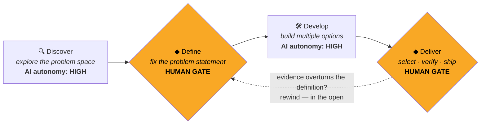

# 🔷🔶 Double Diamond Harness

> A human-in-the-loop process prompt for AI agents.
> **The AI diverges. The human converges.**

[](LICENSE)
[](#usage)
[](PROCESS.md)
[](PROCESS.ko.md)

LLMs collapsed the cost of the *middle* of the problem-solving loop — generating
ideas and building prototypes is now nearly free. What's left as the bottleneck
is the two ends: **defining the right problem** and **judging whether it's actually
solved**. Those are human jobs, and most agent setups have no structural place
for them — the agent happily sprints, at 10× speed, toward the wrong problem.

This repo is a single markdown prompt that fixes that. It puts the classic
[Double Diamond](https://www.designcouncil.org.uk/our-resources/framework-for-innovation/)
design framework (UK Design Council) into your agent harness, with **hard
human gates at every convergence point**.

## The model



| Phase | Mode | AI autonomy | The human… |
|---|---|---|---|
| **Discover** | diverge | 🟢 high | sets scope, steers |
| **Define** ◆ | converge | 🔴 low | **chooses the problem statement** |
| **Develop** | diverge | 🟢 high | prunes options mid-flight |
| **Deliver** ◆ | converge | 🟡 medium | **selects, verifies, approves shipping** |

Three rules do most of the work:

1. **Gates are hard.** The agent may not pass Define or Deliver without explicit
   human approval — and it doesn't pre-work the next phase while waiting.
2. **Each phase has explicit "must NOT do" rules.** No solutions during Discover
   (premature convergence), no silently editing the problem statement during
   Develop, no "predicted user feedback" during Deliver.
3. **Rewinding is public.** New evidence can overturn an earlier conclusion,
   but the agent reports *what flipped and why* — it never quietly patches history.

The full rules live in **[PROCESS.md](PROCESS.md)** (English) /
**[PROCESS.ko.md](PROCESS.ko.md)** (한국어). It applies equally well to software,
papers, and competition entries — the phases map 1:1 onto
*background → problem setup → method → evaluation*.

## Usage

The prompt is plain markdown — no tooling, no dependencies. Wire it into
whatever harness you use:

### Claude Code

Reference it from your project's `CLAUDE.md`:

```bash
curl -fsSL https://raw.githubusercontent.com/sangwonkim98/double-diamond-harness/main/PROCESS.md \
  -o docs/PROCESS.md

cat >> CLAUDE.md <<'EOF'

# Process
For any non-trivial task (new feature, design decision, research), follow the
Double Diamond process defined in docs/PROCESS.md. Respect its Human Gates:
never finalize a problem definition (Define) or select/ship a final option
(Deliver) without my explicit approval.
EOF
```

Or install it as a skill so you can invoke it with `/double-diamond`:

```bash
mkdir -p .claude/skills/double-diamond
curl -fsSL https://raw.githubusercontent.com/sangwonkim98/double-diamond-harness/main/PROCESS.md \
  -o .claude/skills/double-diamond/SKILL.md
```

See [examples/CLAUDE.md](examples/CLAUDE.md) for a complete project file.

### Cursor / Windsurf / other rule-file harnesses

Same idea — drop `PROCESS.md` in the repo and reference it from `.cursorrules`,
`.windsurfrules`, or the equivalent.

### Raw API / custom agents

Append `PROCESS.md` to your system prompt, and enforce the two gates in your
agent loop (e.g., a `request_human_approval` tool the agent must call to leave
Define and Deliver).

### Working the loop

A typical session then looks like:

```
you:   We need a submission for the K-AI award. Start with Discover.
agent: [researches past winners, judging criteria, related work…]
       Exploration summary: 3 patterns, 2 tensions, 4 open questions. → your call on scope
you:   Go to Define.
agent: 5 candidate problem statements, trade-off table, my recommendation is #2 because…
       ◆ Waiting at the Define gate: pick a statement, success criteria, and non-goals.
you:   #2, success = live demo passes X, non-goal = mobile.
agent: [builds 3 prototypes, self-scores each against your criteria…]
       ◆ Waiting at the Deliver gate: comparison table attached, risks listed.
```

## Why gates instead of "just prompt it to be careful"?

Soft instructions ("be thoughtful about the problem") degrade over a long
session. Structural rules survive: a gate is a *state* the agent is in, with an
explicit exit condition the human controls. The same reason CI gates beat
"remember to run the tests."

## Layout

```
├── PROCESS.md      # the prompt (English) — this is the artifact
├── PROCESS.ko.md   # the prompt (Korean original)
├── examples/
│   └── CLAUDE.md   # example Claude Code project integration
└── LICENSE         # MIT
```

## License

[MIT](LICENSE) — use it, fork it, rewrite the phases for your own process.
