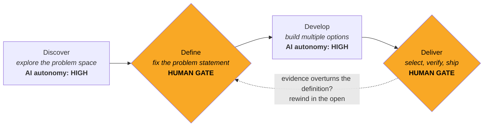

# double-diamond-harness

A single Markdown process prompt that makes an AI agent stop for human approval when the problem is defined and before a result is shipped.

> **Status:** done · **Period:** 2026-07-13 (single release commit) · **Visibility:** public
> **Outcome:** `PROCESS.md` (English) and `PROCESS.ko.md` (Korean original) released under MIT, with an example Claude Code project file.
> **Next step:** none recorded in the repository.

## What and why

LLMs made the middle of the problem-solving loop cheap: generating ideas and building prototypes now costs very little. The two ends are still the bottleneck: defining the right problem, and judging whether it is actually solved. Those are human jobs, and most agent setups give them no fixed place. The agent then works quickly toward the wrong problem.

This repository puts the [Double Diamond](https://www.designcouncil.org.uk/our-resources/framework-for-innovation/) design framework (UK Design Council) into an agent harness, with a hard human gate at each convergence point. It is for anyone who runs a coding or research agent on tasks where the problem statement is not fixed in advance: software features, papers, competition entries. For a paper the phases map onto background, problem setup, method and evaluation.



| Phase | Mode | AI autonomy | The human |
|---|---|---|---|
| Discover | diverge | high | sets scope, steers |
| Define (gate) | converge | low | chooses the problem statement |
| Develop | diverge | high | prunes options mid-flight |
| Deliver (gate) | converge | medium | selects, verifies, approves shipping |

Three rules do most of the work:

1. **Gates are hard.** The agent may not leave Define or Deliver without explicit human approval, and it does not pre-work the next phase while waiting.
2. **Each phase lists what the agent must not do.** No solutions during Discover (premature convergence), no silent edits to the problem statement during Develop, no "predicted user feedback" during Deliver.
3. **Rewinding is public.** New evidence can overturn an earlier conclusion, but the agent reports what flipped and why. It never quietly patches history.

Why gates instead of an instruction such as "be careful about the problem"? Soft instructions fade over a long session. A gate is a state the agent is in, with an exit condition the human controls. It survives for the same reason CI gates work better than "remember to run the tests".

The full rules are in [PROCESS.md](PROCESS.md) (English) and [PROCESS.ko.md](PROCESS.ko.md) (Korean).

## Usage

The prompt is plain Markdown. There is nothing to install and no dependency.

### Claude Code

Reference it from the project's `CLAUDE.md`:

```bash
curl -fsSL https://raw.githubusercontent.com/sangwonkim98/double-diamond-harness/main/PROCESS.md \
  -o docs/PROCESS.md

cat >> CLAUDE.md <<'EOF'

# Process
For any non-trivial task (new feature, design decision, research), follow the
Double Diamond process defined in docs/PROCESS.md. Respect its Human Gates:
never finalize a problem definition (Define) or select/ship a final option
(Deliver) without my explicit approval.
EOF
```

Or install it as a skill and call it with `/double-diamond`:

```bash
mkdir -p .claude/skills/double-diamond
curl -fsSL https://raw.githubusercontent.com/sangwonkim98/double-diamond-harness/main/PROCESS.md \
  -o .claude/skills/double-diamond/SKILL.md
```

[examples/CLAUDE.md](examples/CLAUDE.md) is a complete project file that restates the gates.

### Cursor, Windsurf and other rule-file harnesses

Put `PROCESS.md` in the repository and reference it from `.cursorrules`, `.windsurfrules` or the equivalent file.

### Raw API or custom agents

Append `PROCESS.md` to the system prompt and enforce the two gates in the agent loop, for example with a `request_human_approval` tool the agent must call to leave Define and Deliver.

### A typical session

```
you:   We need a submission for the K-AI award. Start with Discover.
agent: [researches past winners, judging criteria, related work...]
       Exploration summary: 3 patterns, 2 tensions, 4 open questions. Your call on scope.
you:   Go to Define.
agent: 5 candidate problem statements, trade-off table, my recommendation is #2 because...
       Waiting at the Define gate: pick a statement, success criteria, and non-goals.
you:   #2, success = live demo passes X, non-goal = mobile.
agent: [builds 3 prototypes, self-scores each against your criteria...]
       Waiting at the Deliver gate: comparison table attached, risks listed.
```

## Layout

| Path | What it holds |
|---|---|
| `PROCESS.md` | The prompt in English. This is the artifact. |
| `PROCESS.ko.md` | The prompt in Korean (the original). |
| `examples/CLAUDE.md` | Example Claude Code project file that wires in the process. |
| `LICENSE` | MIT. |

## Related

- Project list on the owner's site: https://sangwon.sw-kim.com/projects/

## License

[MIT](LICENSE). Use it, fork it, rewrite the phases for your own process.
